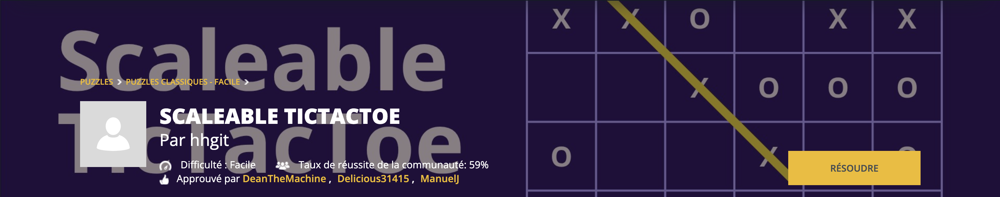

Le puzzle du moment CodinGame du 05-10-2026 au 11-10-2026 était [Scaleable TicTacToe](https://www.codingame.com/training/easy/scaleable-tictactoe).

## Solution

Voici une proposition de solution en C++.

Il s'agit d'une recherche exhaustive d'un *chemin gagnant* (une séquence de ``g`` symboles X ou O égaux successifs, horizontalement, verticalement ou en diagonale).

Je commente la solution dans la section suivante.

```C++
#include <iostream>
#include <string>
#include <vector>
#include <algorithm>
#include <optional>

using namespace std;

class board {

    public:

        // Auxiliary types and their methods

        struct step {
            int di, dj;
        };

        struct cell_coord {
            int i, j;

            void operator+=(step st) {
                i += st.di;
                j += st.dj;
            }
        };

        enum cell_type {
            X, O, Empty
        };
        
        static cell_type cell_of(char c) {
            switch (c) {
                case 'X': return X;
                case 'O': return O;
                default:  return Empty;
            }
        }

        static char char_of_cell_type(cell_type cell) {
            switch (cell) {
                case X:  return 'X';
                case O:  return 'O';
                default: return ' ';
            }
        }
        
        enum path_type {
            Horizontal, Vertical, Diagonal_Up, Diagonal_Down
        };
        static pair<char, step> char_step_of_path_type(path_type type) {
            switch(type) {
                case Horizontal:    return { '-',  {  0, 1 } };
                case Vertical:      return { '|',  {  1, 0 } };
                case Diagonal_Up:   return { '/',  { -1, 1 } };
                case Diagonal_Down: return { '\\', {  1, 1 } };
            };
        }

        struct path {
            cell_coord first;
            path_type type;
        };

        enum end_type {
            X_Wins, O_Wins, Draw, NotOverYet
        };

        static void print_message(end_type outcome) {
            switch(outcome) {
                case X_Wins:
                    cout << "The winner is X." << endl;
                    break;
                case O_Wins:
                    cout << "The winner is O." << endl;
                    break;
                case Draw:
                    cout << "The game ended in a draw!" << endl;
                    break;
                case NotOverYet:
                    cout << "The game isn't over yet!" << endl;
                    break;
            }
        }

        struct result {
            end_type outcome;
            optional<path> winning_path;
        };

        // ----------------------------------------------------------------------
        // Attributes

        vector<cell_type> grid;
        int n; // size of the board
        int g; // length of the winning path
        bool contains_empty = false; // to distinguish between Draw and NotOverYet
        
        // ----------------------------------------------------------------------
        // Constructor
        
        board(int n, int g)
            : grid(n * n), n(n), g(g) {}

        // ----------------------------------------------------------------------
        // Methods

        // Constructs one row of the grid given a string representation
        void create_row(string row, int index_row) {
            const int index_start_row = index_row * n;
            for (int j = 0; j < n; j++) {
                grid[index_start_row + j] = cell_of(row[j]);
                if (row[j] == ' ')
                    contains_empty = true;
            }
        }

        void print_grid(const optional<path>& winning_path) const {

            vector<char> s(n * n);
            for (int i = 0; i < grid.size(); i++) {
                s[i] = char_of_cell_type(grid[i]);
            }

            if (winning_path.has_value()) {
                const auto [ w, st ] = char_step_of_path_type(winning_path->type);
                cell_coord cell = winning_path->first;
                for (int i = 0; i < g; i++) {
                    s[cell.i * n + cell.j] = w;
                    cell += st;
                }
            }

            for (int i = 0; i < n; i++) {
                for (int j = 0; j < n; j++) {
                    cout << s[i * n + j];
                }
                cout << endl;
            }
        }

        // Auxiliary function
        // Searches for a winning path starting from cell (i,j), with specified path type
        optional<result> search(int i, int j, path_type p_type) const {
            int sequence_length = 0;
            
            cell_coord first = { -1, -1 };
            const auto [ _, st ] = char_step_of_path_type(p_type);
            
            cell_coord pos = { i - st.di, j - st.dj };
            cell_type current_type = Empty;

            for (int k = 0; k < n; k++) {

                pos += st;
                if (pos.i < 0 || pos.i >= n || pos.j < 0 || pos.j >= n)
                    break;
                
                cell_type cell = grid[pos.i * n + pos.j];
                
                if (cell != Empty && cell == current_type) {
                    sequence_length++;
                    if (sequence_length == g)
                        return result {
                            (cell == X) ? X_Wins : O_Wins,
                            optional<path>({ first, p_type })
                        };
                }
                else {
                    sequence_length = 1;
                    first = { pos.i, pos.j };
                    current_type = cell;
                }
            }
            return nullopt;
        }

        // Main search function
        result search_for_winning_path() const {

            // Horizontal
            for (int i = 0; i < n; i++) {
                const optional<result> res = search(i, 0, Horizontal);
                if (res.has_value())
                    return res.value();
            }

            // Vertical
            for (int j = 0; j < n; j++) {
                const optional<result> res = search(0, j, Vertical);
                if (res.has_value())
                    return res.value();
            }
            
            // Diagonals
            // Starting in the top and bottom rows
            for (int i_start = 0; i_start < n; i_start += n - 1) {
                for (int j = 0; j < n; j++) {
                    const optional<result> res_up = search(i_start, j, Diagonal_Up);
                    if (res_up.has_value())
                        return res_up.value();

                    const optional<result> res_down = search(i_start, j, Diagonal_Down);
                    if (res_down.has_value())
                        return res_down.value();
                }
            }
            // Starting in the first column
            for (int i = 0; i < n; i++) {
                const optional<result> res_up = search(i, 0, Diagonal_Up);
                if (res_up.has_value())
                    return res_up.value();

                const optional<result> res_down = search(i, 0, Diagonal_Down);
                if (res_down.has_value())
                    return res_down.value();
            }
            return {
                contains_empty ? NotOverYet : Draw,
                nullopt
            };
        }
};

int main()
{
    int n;
    int g;
    cin >> n >> g; cin.ignore();

    board bd(n, g);

    for (int i = 0; i < n; i++) {
        string row;
        getline(cin, row);
        //cerr << "debug: |" << row << "|" << endl;

        bd.create_row(row, i);
    }

    board::result res = bd.search_for_winning_path();
    bd.print_grid(res.winning_path);
    board::print_message(res.outcome);
}
```

## Commentaires de la solution

### **Utilisation d'une classe ``board``**

Cela me permet de stocker toutes les informations dont j'ai besoin dans un seul objet ``board``.

```C++
class board {

    public:
        // ...

        // Attributs :
        vector<cell_type> grid;
        int n; // size of the board
        int g; // length of the winning path
        bool contains_empty = false;

        // Constructeur
        board(int n, int g)
            : grid(n * n), n(n), g(g) {}

        // ...
        // Méthodes pour manipuler l'objet...
};
```

Les fonctions (*méthodes* en programmation orientée-objet) qui sont définies ensuite à l'intérieur de la classe peuvent manipuler les attributs de ma classe, sans les prendre en paramètre.

### **Représentation de la grille**

J'utilise un simple [**``vector``**](../../../cours/fiches/vector.qmd) 1D pour représenter la grille. Celle-ci est composée de $n$ lignes et $n$ colonnes : je stocke les lignes bout à bout dans un ``vector`` de longueur $n \times n$.

- Dans la définition de ``board``, je construis l'attribut ``grid`` avec l'argument ``n * n``.

```C++
vector<cell_type> grid;
// ...

board(int n, int g)
    : grid(n * n), n(n), g(g) {}
```

- J'accède à la case de position ``pos`` (ligne ``pos.i``, colonne ``pos.j``) avec :

```C++
cell_type cell = grid[pos.i * n + pos.j];
```

### **Définition des types**

Je définis des types pour tous les concepts dont j'ai besoin.

J'utilise des [**types énumérés**](../../../cours/fiches/enum.qmd) pour clarifier au maximum mon code :

- ``cell_type { X, O, Empty };`` : pour représenter la valeur d'une case. La grille contenue dans l'objet ``board`` a le type ``vector<cell_type>``.
- ``path_type { Horizontal, Vertical, Diagonal_Up, Diagonal_Down };`` : pour représenter les quatre types de chemins possibles.
- ``end_type { X_Wins, O_Wins, Draw, NotOverYet };`` : pour représenter les quatre issues possibles de la partie.

Je définis (à l'intérieur de la classe ``board``) les [**types structurés**](../../../cours/fiches/struct.qmd) suivants :

- ``cell_coord`` : un couple d'indices pour représenter une case de la grille.
- ``step`` : à ajouter à un ``cell_coord`` pour avancer d'une case (avec l'opérateur ``+=`` que je redéfinis). Cela me permet de factoriser la recherche pour les quatres types de chemins (``path_type``).
- ``path`` : contient les informations nécessaires pour décrire un chemin, sa case de départ et son type.
- ``result`` : résultat de la recherche, contient un type d'issue (``end_type``) et possiblement un chemin gagnant.

Tous ces types permettent de simplifier l'écriture et le débuggage du code, et de le clarifier au point de le rendre presque *auto-documenté*.

### **Recherche de chemin gagnant :**

- La fonction de recherche a pour prototype : ``result search_for_winning_path() const;``.  
   Elle ne prend pas de paramètre (elle peut manipuler la grille directement), elle renvoie un ``result`` et ne modifie pas la grille (``const``). Le ``const`` est totalement optionnel, mais il permet de clarifier le code.  
   La fonction effectue une recherche de chemin gagnant via la fonction auxiliaire ``search`` sur toutes les lignes, toutes les colonnes, et en diagonal à partir de la première ligne, la dernière ligne et la première colonne.

- La fonction ``search`` a pour prototype : ``optional<result> search(int i, int j, path_type p_type) const;``.  
   Elle effectue la recherche à partir de la case $(i,j)$ donnée, et dans la direction donnée par le ``path_type``.  
   Elle renvoie un ``optional<result>``, afin de distinguer les appels qui ont échoué et ceux qui ont effectivement trouvé une solution.  
   [**Fiche sur le conteneur ``optional``**](../../../cours/fiches/optional.qmd)

### **Fonction ``main``**

La fonction ``main`` réalise :

- La lecture des entrées, avec construction de la représentation de la grille.   

    ```C++
    int n;
    int g;
    cin >> n >> g; cin.ignore();

    board bd(n, g);

    for (int i = 0; i < n; i++) {
        string row;
        getline(cin, row);
        bd.create_row(row, i);
    }
    ```

- La recherche de solution :  

    ```C++
    board::result res = bd.search_for_winning_path();
    ```
    A noter que le type ``result`` est défini à l'intérieur de la classe ``board``, il s'écrit donc ``board::result`` lorsque l'on est dans la fonction ``main``.

- L'affichage de la solution :  

    ```C++
    bd.print_grid(res.winning_path);
    board::print_message(res.outcome);
    ```
    De même, la méthode ``print_message`` est *statique*, c'est-à-dire qu'elle est associée à la classe elle-même et non à une instance précise. On l'appelle donc avec ``board::print_message``.

## Notions utiles

- [**vector**](../../../cours/fiches/vector.qmd) : pour stocker la grille, avec les lignes bout à bout
- [**optional**](../../../cours/fiches/optional.qmd) : pour stocker une valeur, ou *aucune valeur*, par exemple pour une recherche de solution qui peut être infructueuse
- [**enum**](../../../cours/fiches/enum.qmd) : pour représenter explicitement des cas possibles (ex : ``X_Wins, O_Wins, Draw, NotOverYet``)
- [**struct**](../../../cours/fiches/struct.qmd) : pour conserver plusieurs informations dans un même objet (ex : ``struct cell_coord { int i, j; };``)